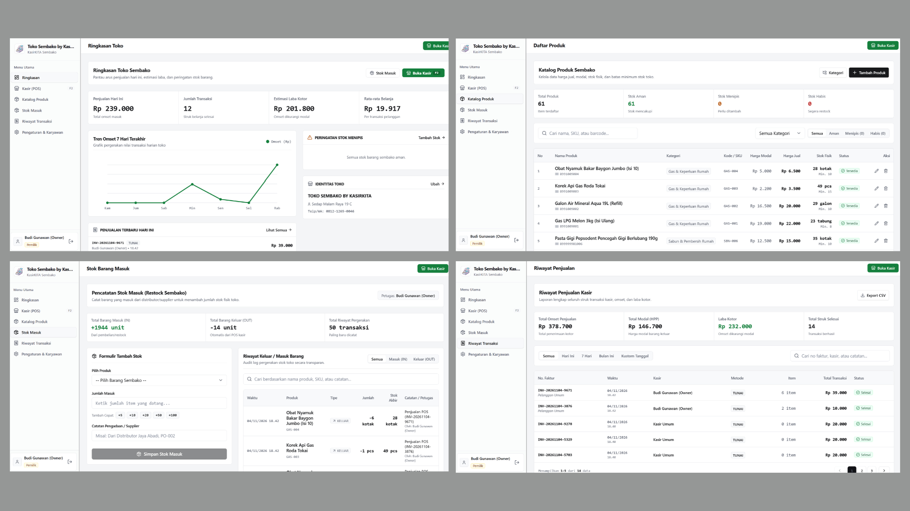
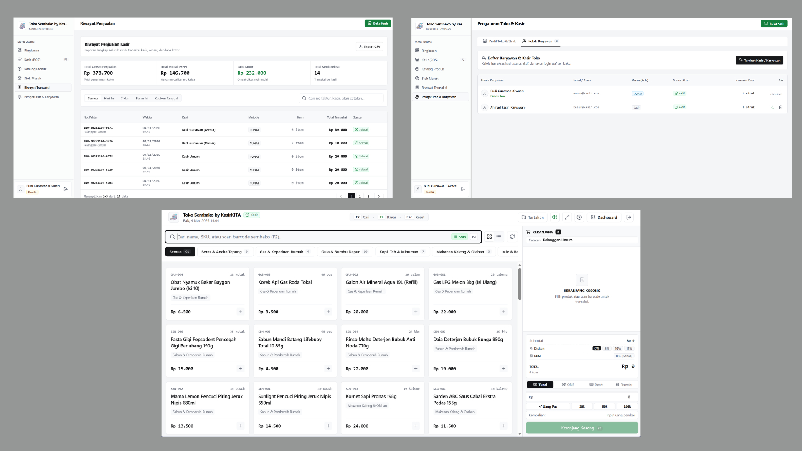

# KasirKITA — Sistem Point of Sales & Manajemen Stok UMKM

Aplikasi kasir (Point of Sale) dan manajemen stok barang untuk toko sembako atau warung kelontong UMKM. Dibuat menggunakan **Next.js 16 (App Router)**, **React 19**, **Tailwind CSS v4**, **MySQL 8.0**, dan **Prisma ORM**.

Aplikasi ini sudah dilengkapi sistem proteksi transaksi database *(idempotency key & concurrency safety)* agar tidak terjadi transaksi dobel saat tombol diklik berkali-kali atau koneksi sedang tidak stabil.

---

## Preview Aplikasi

<p align="center">
  
</p>

<p align="center">
  
</p>

---

## Fitur Utama

### 1. Halaman Kasir / POS (`/pos`)
- **Tampilan Desktop & Mobile**: Nyaman dipakai di komputer kasir, tablet, maupun HP dengan drawer keranjang yang responsif.
- **Pencarian Cepat**: Cari barang lewat nama, SKU, atau scan barcode.
- **Metode Pembayaran Lengkap**:
  - Tunai (ada kalkulator kembalian dan opsi uang pas).
  - QRIS (menampilkan dummy QR code dinamis).
  - Kartu Debit.
  - Transfer Bank (menampilkan nomor rekening toko).
- **Konfirmasi Pembayaran Sebelum Struk Keluar**: Kasir bisa memastikan pembayaran uang/QRIS/transfer sudah masuk dulu sebelum struk dicetak atau bisa mengganti metode pembayaran jika pembeli berubah pikiran.
- **Tahan & Panggil Transaksi (Hold & Recall)**: Simpan sementara belanjaan pelanggan yang sedang antre untuk melayani pelanggan berikutnya, lalu panggil kembali kapan saja.
- **Cetak Struk**: Format struk siap cetak untuk printer thermal (58mm/80mm), lengkap dengan nama toko, alamat, dan rincian belanja.
- **Shortcut Keyboard**:
  - `F2` atau `/` : Langsung fokus ke pencarian produk.
  - `F9` : Buka modal pembayaran.
  - `Spasi` : Set uang tunai sesuai total belanja (uang pas).
  - `Esc` : Tutup modal / batal.

### 2. Manajemen Stok Barang (`/stock-in` & `/products`)
- **Pencatatan Stok Masuk**: Form penerimaan barang dari supplier dengan pilihan produk cepat dan tombol tambah instan (+10, +25, +50, +100).
- **Riwayat Mutasi Stok**:
  - Mencatat keluar-masuk barang secara detail (stok sebelum, stok sesudah, tanggal, catatan, dan nama kasir/petugas).
  - Ada filter tipe mutasi (Semua, Masuk, Keluar) serta pencarian nama barang atau SKU.
  - **Paginasi Riwayat**: Dibatasi maksimal 5 data per halaman agar tampilan rapi dan tidak memanjang ke bawah.
- **Peringatan Stok Menipis**: Indikator otomatis di dashboard ketika sisa stok sudah menyentuh batas minimum.

### 3. Keamanan Transaksi & Anti-Duplikasi
- **Idempotency Key di Database**: Mencegah transaksi atau penambahan stok terproses dua kali akibat double click atau jaringan terputus.
- **Row-Level Mutex (InnoDB)**: Menjamin stok tidak berkurang ganda ketika dua kasir memproses pesanan secara bersamaan saat stok menipis.
- **Payload Hash Matching**: Memverifikasi kesesuaian data menggunakan hash SHA-256 agar request yang sama tidak bisa disalahgunakan untuk transaksi berbeda.

### 4. Dashboard & Laporan Penjualan (`/dashboard` & `/transactions`)
- Ringkasan omzet harian, laba kotor, total transaksi, dan produk terlaris.
- Grafik tren penjualan harian.
- Riwayat transaksi lengkap dengan filter rentang tanggal dan tombol ekspor data ke Excel / CSV.

### 5. Multi-User & Pengaturan Toko (`/settings`)
- **Pembagian Role**:
  - **Owner**: Akses penuh ke seluruh menu, laporan laba rugi, data karyawan, dan pengaturan toko.
  - **Karyawan / Kasir**: Fokus ke operasional transaksi POS dan stok masuk.
- **Profil Toko**: Kustomisasi nama toko, alamat, nomor HP, catatan footer struk, serta upload logo toko.

---

## Tech Stack

- **Framework**: Next.js 16 (App Router)
- **UI & Bahasa**: React 19, TypeScript
- **Styling**: Tailwind CSS v4
- **Database**: MySQL 8.0 (XAMPP lokal)
- **ORM**: Prisma ORM
- **Icons**: Lucide React

---

## Kebutuhan Sistem

Pastikan hal-hal berikut sudah terpasang di komputer:

1. Node.js versi 20 ke atas.
2. XAMPP Control Panel dengan layanan **MySQL** yang aktif.
3. phpMyAdmin (tersedia bersama XAMPP).
4. Git.

> Project ini tidak memerlukan Docker Desktop untuk alur development lokal.

---

## Cara Instalasi & Menjalankan

### 1. Clone repositori
```bash
git clone https://github.com/patihrz/sistem-point-of-sales-kasir-sederhana-umkm.git
cd sistem-point-of-sales-kasir-sederhana-umkm
```

### 2. Install dependensi
```bash
npm install
```

### 3. Siapkan file konfigurasi environment
Salin `.env.example` menjadi `.env`:

**Windows (PowerShell):**
```powershell
Copy-Item .env.example .env
```

**Linux / macOS:**
```bash
cp .env.example .env
```

Pastikan `.env` berisi koneksi MySQL XAMPP:
```env
DATABASE_URL="mysql://root@127.0.0.1:3306/kasir_simpel"
NEXTAUTH_SECRET="kunci_rahasia_bebas_diisi_apa_saja"
NEXTAUTH_URL="http://localhost:3000"
NEXT_PUBLIC_APP_NAME="KasirKITA"
NODE_ENV="development"
```

Jika MySQL XAMPP Anda menggunakan password, sesuaikan URL secara aman dengan URL encoding karakter khusus.

### 4. Jalankan XAMPP dan buat database
1. Buka **XAMPP Control Panel**.
2. Klik **Start** pada layanan **MySQL**.
3. Buka `http://localhost/phpmyadmin`.
4. Buat database dengan nama `kasir_simpel` (collation: `utf8mb4_unicode_ci`).

### 5. Setup database (migrasi + data awal)
Jalankan perintah ini dari root project:
```bash
npm run db:setup
```

Perintah di atas akan:
- mengecek koneksi MySQL lokal,
- menghasilkan Prisma Client,
- menjalankan migrasi database,
- mengisi data awal demo, tanpa menggunakan Docker.

### 6. Jalankan aplikasi
```bash
npm run dev
```

Buka browser dan buka **http://localhost:3000**.

---

## Akun Demo untuk Login

| Peran | Email | Password | Hak Akses |
|---|---|---|---|
| **Owner** | `owner@kasir.com` | `owner123` | Akses semua menu (Dashboard, Laporan, Karyawan, Pengaturan) |
| **Kasir** | `kasir@kasir.com` | `kasir123` | Transaksi POS, Stok Masuk, dan Riwayat Penjualan |

*(Di halaman login juga disediakan tombol klik cepat untuk langsung masuk tanpa perlu ketik manual).* 

---

## Perintah yang Tersedia (NPM Scripts)

| Perintah | Keterangan |
|---|---|
| `npm run dev` | Menjalankan server lokal (mode development) |
| `npm run build` | Membangun aplikasi produksi (setelah generate Prisma) |
| `npm run start` | Menjalankan aplikasi dari hasil build produksi |
| `npm run db:setup` | Menyiapkan database XAMPP, migrasi, dan data demo |
| `npm run db:generate` | Menghasilkan Prisma Client |
| `npm run db:migrate` | Menjalankan migrasi Prisma dev |
| `npm run db:studio` | Membuka Prisma Studio |
| `npm run db:seed` | Mengisi ulang data contoh produk dan akun demo |
| `npm run test:idempotency` | Menjalankan pengujian otomatis konkurensi & proteksi transaksi |

---

## Melihat Database Langsung (phpMyAdmin)

Jika ingin melihat atau mengelola isi tabel database lewat antarmuka web:
- **URL**: http://localhost/phpmyadmin
- **Server**: `localhost` atau `127.0.0.1`
- **Username**: `root`
- **Password**: kosong (default XAMPP) atau sesuai konfigurasi yang Anda pakai
- **Database**: `kasir_simpel`

---

## Lisensi

Proyek ini menggunakan lisensi [MIT](LICENSE). Bebas dipakai, dimodifikasi, dan dikembangkan untuk keperluan usaha atau bahan belajar.
